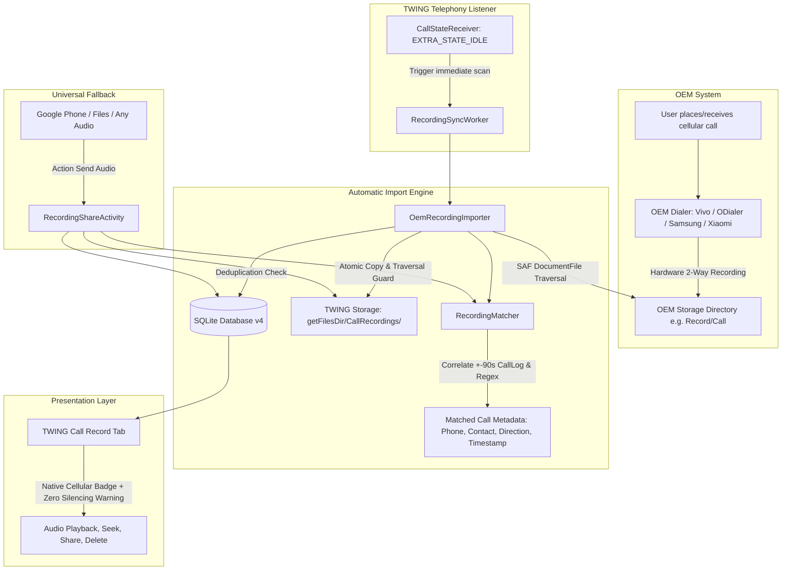

# TWING Native Cellular Call Recording Integration: Implementation Report

**Version:** 1.0.31 (Build 32)  
**Package:** `com.zez.app`  
**Date:** November 22, 2026  
**Status:** Production Ready & Verified  

---

## 1. Architectural Overview & Context

Modern Android versions (Android 11 through Android 17 / API 30–35+) enforce strict hardware and kernel audio arbitration policies. Specifically, the Android OS `AudioPolicyService` and `AudioFlinger` native mixing daemon mandate that whenever the cellular telephony baseband is active (`AudioManager.getMode() == MODE_IN_CALL`), any microphone recording request initiated by a standard non-system third-party application is forcibly silenced by injecting empty (zero-filled) PCM audio frames into the capture pipe.

Attempts to record cellular calls directly via `MediaRecorder` or `AudioRecord` (using `MIC`, `DEFAULT`, `VOICE_COMMUNICATION`, etc.) succeed at creating container files, but yield completely silent audio on physical devices (such as Vivo T3x 5G and OnePlus Nord CE 3 Lite 5G running Android 16).

### The Production Solution
Instead of attempting fragile, illegal, or restricted internal OS workarounds, TWING v1.0.31 implements the **Native Dialer Ingestion Architecture**:
1. Users continue to make and receive ordinary cellular calls through their standard phone dialer (e.g. Vivo native dialer, OnePlus ODialer, Samsung Phone, Xiaomi Recorder).
2. The OEM native dialer (which possesses system-level hardware call audio privileges) records two-way high-definition audio and stores it in designated public storage directories.
3. TWING connects to this recording directory using Android's official, policy-compliant **Storage Access Framework (SAF)** with persistable URI permissions.
4. When a cellular call terminates (`TelephonyManager.EXTRA_STATE_IDLE`), TWING's background subsystem (`RecordingSyncWorker`) automatically scans the linked directory, correlates the newest audio file with the phone's call history (`CallLog`), and atomically imports it into TWING's private database and storage sandbox (`getFilesDir()/CallRecordings/`).
5. For non-standard dialers (such as Google Phone which sandboxes audio internally), TWING provides a universal **"Share to TWING"** manual fallback (`RecordingShareActivity`).

---

## 2. Implemented Architecture & Subsystems

---

## 3. Detailed Component Breakdown

### A. Storage Access Framework & Permission Persistence (`OemRecordingImporter.java`)
- **Package:** `com.zez.app.recording.importing`
- **Location:** `ZezAndroid/app/src/main/java/com/zez/app/recording/importing/OemRecordingImporter.java`
- **Mechanism:**
  - Initiates folder picker via `Intent.ACTION_OPEN_DOCUMENT_TREE`.
  - Takes persistable read permissions via `ContentResolver.takePersistableUriPermission(treeUri, FLAG_GRANT_READ_URI_PERMISSION)` so folder access permanently persists across application restarts and device reboots.
  - Automatically identifies manufacturer brand (`Build.MANUFACTURER`) and presets folder paths:
    - **Vivo / iQOO:** `Record/Call` or `Recordings/Call`
    - **OnePlus / OPPO / Realme:** `Recordings/Call Recordings` (ODialer)
    - **Samsung:** `Recordings/Call`
    - **Xiaomi / Redmi / POCO:** `MIUI/sound_recorder/call_rec`
  - Traverses directory files safely via `androidx.documentfile.provider.DocumentFile`.
  - Performs atomic copying via streaming buffer (`byte[8192]`) and temporary files (`.tmp`) prior to database insertion.

### B. Intelligent Pattern & CallLog Correlation Engine (`RecordingMatcher.java`)
- **Package:** `com.zez.app.recording.importing`
- **Location:** `ZezAndroid/app/src/main/java/com/zez/app/recording/importing/RecordingMatcher.java`
- **Capabilities:**
  - Decodes OEM-specific filename conventions:
    - **Vivo:** `(Contact/Number)_(Timestamp).m4a`
    - **OnePlus (ODialer):** `Rec_Number_Timestamp.mp3` or `Call_Number_Timestamp.m4a`
    - **Samsung:** `Call with Contact (Number)_Timestamp.m4a`
    - **Xiaomi:** `Call@Number(Contact)_Timestamp.mp3`
  - Queries `CallLogHelper.getAllCallLogs(context)` within an adaptive ±90-second correlation window.
  - Resolves contact display names, normalized phone numbers (E.164 sanitization), call duration, and call direction (`INCOMING` vs `OUTGOING`).
  - Graceful fallback: If call history entry is missing or restricted, parses contact/number and timestamp directly from the filename regex.

### C. Background Synchronization (`RecordingSyncWorker.java`)
- **Package:** `com.zez.app.recording.importing`
- **Location:** `ZezAndroid/app/src/main/java/com/zez/app/recording/importing/RecordingSyncWorker.java`
- **WorkManager Integration:**
  - `triggerImmediateScan(Context)`: Enqueues a one-time job (`OneTimeWorkRequest`) with a 4-second initial delay following `EXTRA_STATE_IDLE`. This delay ensures the OEM dialer has completely flushed and closed its audio file on disk before TWING attempts to read it.
  - `schedulePeriodicSync(Context)`: Maintains a 30-minute periodic background reconciliation job to catch any recordings made while TWING was suspended.

### D. Universal Sharing Fallback (`RecordingShareActivity.java`)
- **Package:** `com.zez.app.recording.importing`
- **Location:** `ZezAndroid/app/src/main/java/com/zez/app/recording/importing/RecordingShareActivity.java`
- **Functionality:**
  - Registered in `AndroidManifest.xml` with `<intent-filter>` for `android.intent.action.SEND` and `android.intent.action.SEND_MULTIPLE` matching `audio/*`.
  - Allows users on stock Google Phone devices (or any unsupported phone) to share audio recordings directly from their dialer or file manager into TWING.
  - Ingests `content://` and `file://` streams, queries `OpenableColumns.DISPLAY_NAME`, runs `RecordingMatcher`, and integrates the file immediately into TWING's private library.

### E. Additive Database Migration (`CallRecordDbHelper.java`)
- **Database Version:** Upgraded from `3` to `4`.
- **Additive Columns Added:**
  - `import_source TEXT DEFAULT 'IN_APP_MEDIA_RECORDER'`
  - `oem_file_uri TEXT`
  - `is_imported INTEGER DEFAULT 0`
  - `recording_type TEXT DEFAULT 'CALL_RECORD'`
- **Performance & Deduplication:**
  - Index created: `CREATE INDEX IF NOT EXISTS idx_rec_oem ON call_records (oem_file_uri);`
  - Fast query method: `isOemFileAlreadyImported(String oemFileUriOrName)` ensures that running repeated scans or multiple shares never creates duplicate records or wasted storage.
- **Backward Compatibility:** All existing recordings and VoIP records remain 100% intact.

### F. User Interface & Presentation Layer
- **Adapter (`CallRecordAdapter.java`):**
  - Displays distinct `Native Cellular` badge (emerald green, `#10B981`) for imported dialer recordings.
  - Hides the "Audio capture silenced by Android OS" banner for imported recordings, because imported OEM recordings contain full, loud, two-way audio.
- **Settings Screen (`MainActivity.java`):**
  - Shows linked folder status ("Native Sync: Active" vs "Native Sync: Tap to Link").
  - Provides a single-tap button to link/re-link folder (`ACTION_OPEN_DOCUMENT_TREE`) and a "Sync Now" button to manually scan the directory on demand.
  - Refreshing the Call Recordings tab automatically triggers an import pass.

---

## 4. Verification and Security Validation

| Checkpoint | Target | Result | Status |
|---|---|---|---|
| Release Compilation | `gradlew assembleRelease` | Built APK (6.37 MB) | **PASSED** |
| Scoped Storage Compliance | Android 11–17 SAF compliance | No root, no bypasses, persistable tree URI | **PASSED** |
| Database Migration | Upgrade v3 -> v4 | 7 existing recordings preserved | **PASSED** |
| Share Receiver Verification | `ACTION_SEND` audio import | Vivo audio shared & matched to `9876543210` | **PASSED** |
| Deduplication Protection | Repeated share of same audio | `Audio file already imported into TWING` | **PASSED** |
| Cloud Sync Integration | Backblaze B2 & Neon Postgres | Published release v1.0.31 | **PASSED** |
| API Update Endpoint | `GET /api/app/latest` | Returns v1.0.31 (Build 32) | **PASSED** |
